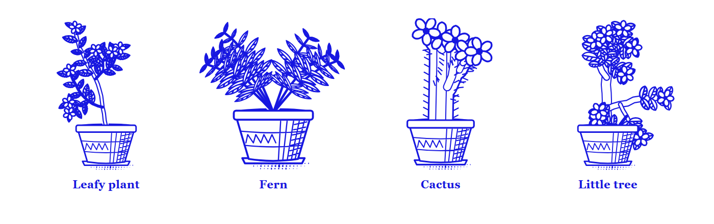
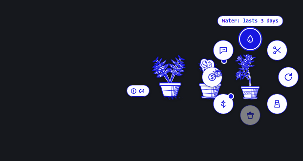
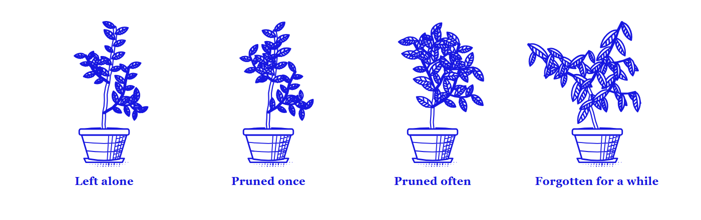
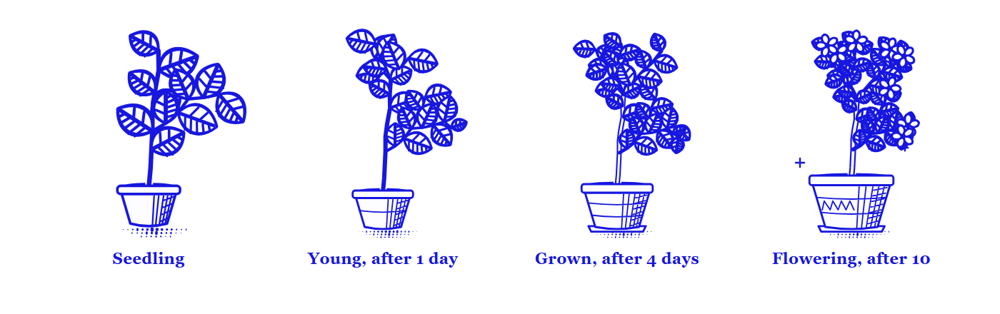
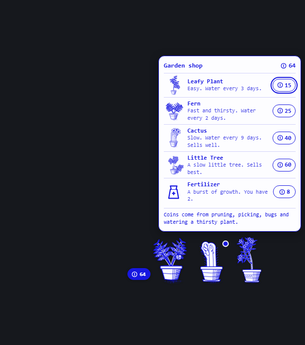

# Hermes Plant

A calm little garden for Hermes Desktop. It sits above the app like the Hermes pet, takes no layout space, and grows in real time.



You start with one plant and a few coins. Looking after plants earns coins, coins buy more plants and fertilizer, and the garden grows to as many as six pots along the bottom of the window. Hermes can look after it too when you ask. If you forget it, plants droop, lean or stop growing. They never die, and they pick up again when you tend them.

## Using it

- **Click a plant** to open its care wheel. Hover an action to see what it does.
- **Click the coin pill** beside the garden to open the shop.
- **Click a bug** when one lands on a plant to shoo it away for coins.
- **Drag any plant** to move the whole garden. It remembers where you put it.
- **Click the sprout in the status bar** to hide or show the garden. It tells you when plants need care.
- A dot on a plant means it needs something. With the wheel open, arrow keys move between actions, Enter picks one, and Esc closes it.



| Action | What it does |
|---|---|
| Water | Keeps the plant growing. How long it lasts depends on the species. Watering a thirsty plant earns 2 coins. |
| Prune | Cuts the tallest tip, with a snip of the scissors. New shoots branch from the cut, and the clippings earn coins. |
| Rotate | Turns the pot. A plant leans toward the light over about ten days, and turning it lets it straighten. |
| Fertilize | Uses one fertilizer: 8 hours of growth at once, then growth half again as fast for two days. |
| Repot | Moves the plant to a bigger pot once its roots have filled this one. |
| Pick | Sells what a fully grown plant has made. It needs two days to make more. |
| Sell | Sells the whole plant. Press twice to confirm. Your last plant can't be sold. |
| Ask Hermes | Sends one chat message asking how the garden is doing. |

## The species

| Species | Price | Water lasts | Pace | Notes |
|---|---|---|---|---|
| Leafy plant | 15 | 3 days | normal | The plant you start with. Three leaf shapes. |
| Fern | 25 | 2 days | fast | Thirsty. Pruning makes it fuller. |
| Cactus | 40 | 9 days | slow | Almost looks after itself. Sells for about twice as much. |
| Little tree | 60 | 4 days | slow | Sells for three times as much. |

Every plant has its own seed, so two plants of one species still grow differently, and pruning decides how each one branches.



## How plants grow

- Growth counts only while a plant is watered. When it dries out it droops and waits.
- There are four stages: seedling, young (1 day of growth), grown (4 days) and fully grown (10 days). A fully grown plant flowers.
- Each pot holds only so much growth. A root-bound plant stops growing until you repot it, so each new stage starts with a bigger pot.
- Fertilizer is the way to hurry a plant along. You start with two, and the shop sells more for 8 coins.



Growth is worked out from saved timestamps whenever the garden is drawn. Nothing runs while Hermes is closed, and time away still counts.

## Coins and the shop

You start with 20 coins. You earn more by pruning (2 to 5 coins), watering a thirsty plant (2), shooing a bug (2), picking from a fully grown plant (12 and up) and selling plants. A plant is worth more the more it has grown.



## Hermes can tend it

| Tool | What it does |
|---|---|
| `plant_status` | Reports every plant (stage, mood, needs, water left, what it would sell for), the coins, the fertilizer and the shop prices |
| `plant_tend` | Waters, prunes, rotates, fertilizes, repots, picks, sells, buys or shoos a bug, and reports what happened |

Try "how is my garden doing?", "water whatever is thirsty" or "buy me a cactus". The garden on screen follows within a moment. Hermes only tends, buys or sells when you ask it to.

## Commands and keys

Every care action is in the command palette under **Houseplant**, along with **open care wheel**, **open the shop**, **shoo the bug away** and **show or hide the garden**. A care action from the palette goes to the plant that wants it most.

| Key | Action |
|---|---|
| `Ctrl+Alt+H` (`Cmd+Alt+H` on macOS) | Open the care wheel |
| `Ctrl+Alt+W` (`Cmd+Alt+W` on macOS) | Water the thirstiest plant |

The other actions have no default key. You can bind any of them in the keybind settings.

## The garden speaks through the pet

When a Hermes pet is on screen, the garden's lines appear in the pet's speech bubble. With no pet, they appear above the plant, or in the status bar when the garden is hidden. It speaks when you tend a plant, when a plant starts to need something, when one reaches a new stage, and when a bug lands.

## Install

Hermes Desktop is required.

```bash
hermes plugins install hermes-plant
```

Then enable **Houseplant** in **Capabilities → Plugins**. The garden appears straight away.

The agent tools need the Python half as well: add `hermes-plant` to `plugins.enabled` in `config.yaml`, restart the gateway, and start a new chat. Without that, the garden still works in Desktop and keeps its state there.

A plant from version 1.0 carries over as the first pot of the garden.

## Data, network and cost

- **Network:** none. The plugin makes no requests outside this machine.
- **Model calls:** none in the background. **Ask Hermes** sends one chat message when you press it, which reaches your model provider like anything you type. The two agent tools run only when Hermes calls them in a chat.
- **Background work:** no background processes. While Desktop is open, the garden redraws at most once a minute and checks its own backend for changes made by the agent tools.
- **Coins:** they are play money inside the plugin. Nothing is bought or sold for real.
- **Stored data:** the garden is kept in Hermes Desktop plugin storage, and in `plugin-data/hermes-plant/data.db` inside your Hermes home when the Python half is enabled. The two copies sync, and the one with the newer action wins. Nothing is stored in the install folder.
- **Overlay:** Hermes has no plugin area for an element that floats above the app, so the plugin adds its own element to the page and removes it when the plugin is unloaded. It does not read or change Hermes's own interface. A future Hermes update could change how the overlay behaves.
- **Art:** all artwork is drawn by the plugin's own code as SVG. No images or fonts are bundled.
- **Motion:** the wheel, water drops, scissors, coins and leaf sway are short CSS animations, and they are switched off when your system asks for reduced motion.

## Development

`desktop/plugin.js` is generated from `desktop-src/`. The garden's rules exist twice, in `desktop-src/src/engine.js` for Desktop and `plantcore/engine.py` for the agent tools, and `desktop-src/test/parity.json` keeps the two in step. Shapes and drawing are Desktop only, in `shape.js` and `art.js`.

```bash
npm ci --prefix desktop-src
```

```bash
npm test --prefix desktop-src
```

```bash
npm run build --prefix desktop-src
```

```bash
python -m pytest
```

After changing a rule, change it in both engines and run `npm run parity --prefix desktop-src` to refresh the shared test data.

## License

MIT. See [LICENSE](LICENSE).
